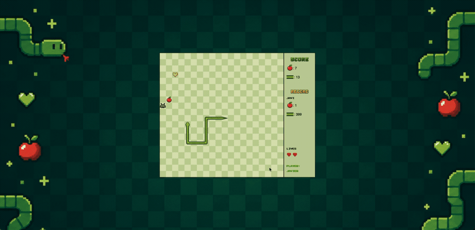
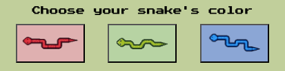

# Module 1 Project: Snake Game
Welcome to my own version of Snake 🐍! In this project I wanted to simulate this iconic retro mobile phone game but adding extra features that enhance the game higher playability



## How to Play
To play the game you just need [to go here](https://javv98.github.io/project-1-snake/).
### Controls
To control the snake movement you need to use the following arrow keys:

| Move Up      | Move Down     |  Move Left  | Move Right   |
|--------------|---------------|-------------| --------------|
| ⬆️ Up arrow    | ⬇️ Down arrow|⬅️ Left arrow| ➡️ Right arrow|

### Skin color
In this game you can choose the color of your snake from three options: red, green or blue. 



### Rules
The rules are simple 
- You need to make the snake as long as the board to win
- The snake grows by eating the apples
- You lose if the snake runs out of lives, collides with the walls or with its own body. 
### Levels 
There are 3 levels, each increasing the difficulty of the game and the speed, adding new challenges to complete the game.
1. Easy level (Slow speed): This level keeps the playability of the original game, just the snake and the apples
2. Medium level (Normal speed): This level adds enemies to the game, if you collide with one of them you will lose a part of your body. If the snake loses all the parts of its body you lose too. 
3. Hard level (Fast speed): This level includes lives for the snake, each time the snake collides with an enemy, besides losing a part of its body, it loses one life. If the snake run out of lives you lose too (here you have golden hearts to recover your lives).

## Game Features

| FEATURES     | INFORMATION |
|--------------|-------------|
| Game         | The game uses a cell-based system drawn on a canvas, so movements, the snake's positions, and objects are all related to the size of a cell, which is calculated by dividing the game size by the desired number of cells. |
| Snake        | The snake can have 3 different colors, changing the sprites used to draw it. It consists of two objects, "Snake" and "Body". "Snake" controls collisions and movement, while "Body" controls adding an object to the Snake's "body" property for each body segment. Both objects ensure their sprites are drawn correctly using properties such as "direction" and "tail". |
| Elements      | There are 3 types of elements in the game: apples, enemies, and lives. All three control where they randomly appear, avoiding positions already occupied by the snake or another object. Each also has specific functions to make the snake grow (in the case of apples), remove a part of its body (in the case of enemies), or add lives (in the case of the golden heart). |
| Levels       | Players can select the level they want to play, and this selection enables or disables certain game features through a property called "level", whose value is passed to the "Game" object. The value of this property is used to control several conditional statements that adjust the gameplay. |
| Scoreboard   | In addition to the main canvas, there is a secondary canvas that displays real-time game information. This scoreboard shows information such as the number of apples eaten, the snake's current length, and (if the level requires it) the player's remaining lives. It also displays the current player's name (entered on the start screen). Also the localStorage is used to display the record of the game.|

## Technologies Used
1. HTML 5. For creating the different screens, with buttons and inputs, and also using IDs and classes that allow DOM manipulation.
2. CSS: Used to style all the screens and also give interactivity to the buttons.
3. JavaScript: Using OOP (Object-Oriented Programming) to create all the objects to the game with its different properties and methods, also control the different listeners to make the buttons, inputs, etc... work
4. Canvas API. Used to render the game itself and the scoreboard. 

## Project Structure

```text
project1-snake/
├── imgs/
├── js/
│   ├── elements/
│   ├── score/
│   ├── constants.js
│   ├── game.js
│   └── index.js
├── sounds/
├── index.html
├── README.md
└── style.css
```

## Author & Acknowledgments

I developed the entire project myself, applying the knowledge I gained from Ironhack's HTML, CSS, and JavaScript module. All images and visual assets were generated using AI, while the sound effects were downloaded from Pixabay's free sound library.